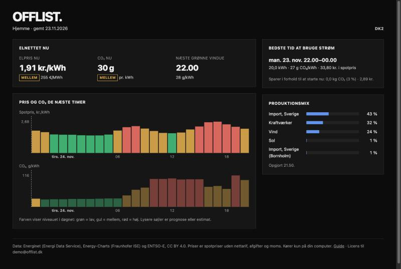

# Offlist for Claude

**Power price, CO₂ and your own EV in Claude, with a dashboard you build by asking.** An extension for Claude Desktop from [OFFLIST](https://offlist.dk). It runs on your own computer.

**Price: 50 kr. or €6.60, one-time.** No subscription. [Buy in kroner](https://offlist.dk/billing) · [Buy in euro](https://offlist.dk/en/billing)

*Dansk version længere nede: [På dansk](#på-dansk).*

## What you can ask

- *"What does power cost right now, and how green is it?"*
- *"When is it greenest to run the dishwasher today?"*
- *"When should the car charge to reach 80 % by 7 am, as green as possible?"*
- *"How much CO₂ did last night's charge emit, and what would the greenest time have given?"*
- *"How many times did I charge this month, and how far did I drive?"*
- *"Build a dashboard for me with power and my car."*

## What it does

**Power, hour by hour**
- Spot price and CO₂ now, and up to 48 hours ahead, with each hour marked low, medium or high for the day.
- The greenest or cheapest time to use a given amount of power, such as charging, the dishwasher or the laundry.
- CO₂ for a charge that has happened, using the grid's CO₂ in exactly those hours.
- Where the power comes from right now: wind, solar, power plants, imports.
- Price and CO₂ across Europe in up to 20 areas.

**Your own EV** (through your own Smartcar app)
- Battery, range, charging status and odometer, read directly from the car. Location is never read.
- A charge plan that reaches your target as green or as cheap as possible.
- History: every charge with kWh and CO₂, and km driven. It is collected around the clock by your own free collector on Cloudflare, also while your computer is off.

**Your dashboard**
- Eight of OFFLIST's dashboard modules, which you combine just by asking Claude. Save up to 10 dashboards.
- It runs on your computer at `localhost`, and nothing is sent to OFFLIST.

## Where the data comes from

| Area | Source | Key |
|---|---|---|
| Denmark (DK1, DK2) | Energinet, Energi Data Service | None |
| Germany, Poland, Netherlands, Belgium, France, Italy, Switzerland, Austria | Energy-Charts (Fraunhofer ISE) | None |
| Sweden, Norway, Finland, flows between countries | ENTSO-E | Your own free key |
| Your car | Smartcar | Your own Smartcar app |

Prices are spot prices without grid tariffs, taxes and VAT.

## Requirements

- Claude Desktop on Mac or Windows.
- For the car: your own app at [Smartcar](https://smartcar.com). Smartcar charges per connected car, so you pay Smartcar directly. You can try everything with Smartcar's simulated cars first.
- For the car's history: a free Cloudflare account for your collector.

## Local or hosted?

| | Offlist for Claude | Hosted OFFLIST |
|---|---|---|
| Price | 50 kr. / €6.60 one-time | 39 kr. per month |
| Where | Claude Desktop on your computer | [offlist.dk](https://offlist.dk) in any browser |
| Car | Your own Smartcar app | Included |
| History | With your own collector | Included |

## How it works

1. **Buy:** You buy once. Right after payment you get the file, a personal licence key and a link by email.
2. **Install:** Double-click the file to install it in Claude Desktop, then paste the key.
3. **Ask:** Ask Claude.

The [guide](https://johanschnor.github.io/offlist-for-claude/) (in Danish) covers installation, the Nordics and connecting your car.

The licence is personal: the key carries the buyer's email, which is shown on the dashboard. This repository has no source code. Offlist for Claude is closed source.

**Questions:** contact.offlist@gmail.com

---

## På dansk

**Elpris, CO₂ og din egen elbil i Claude, med et dashboard du bygger ved at spørge.** En udvidelse til Claude Desktop fra [OFFLIST](https://offlist.dk). Den kører på din egen computer.

**Pris: 50 kr. én gang.** Intet abonnement. [Køb på offlist.dk](https://offlist.dk/billing)

**Det kan du:**
- **Strøm:** Elpris og CO₂ nu og op til 48 timer frem, time for time.
- **Bedste tid:** Den grønneste eller billigste tid til opvask, vask eller ladning.
- **CO₂ for en ladning:** Udregnet ud fra elnettets CO₂ i præcis de timer, bilen ladede.
- **Produktionsmix og Europa:** Hvor strømmen kommer fra lige nu, og pris og CO₂ i op til 20 områder.
- **Din elbil:** Batteri, rækkevidde og en ladeplan via din egen Smartcar-app. Bilens position læses aldrig.
- **Bilens historik:** Ladninger, kWh, CO₂ og kilometer, samlet døgnet rundt af din egen gratis opsamler på Cloudflare.
- **Dit dashboard:** Otte af OFFLISTs moduler, som du sætter sammen bare ved at spørge Claude.

**Datakilder:**
- **Danmark:** Energinet. Ingen nøgle.
- **8 andre lande:** Energy-Charts. Ingen nøgle.
- **Norden:** ENTSO-E, med din egen gratis nøgle.

Priserne er spotpriser uden nettarif, afgifter og moms.

**Kræver:** Claude Desktop på Mac eller Windows. Til bilen skal du have din egen Smartcar-app, og du betaler selv Smartcar.

**Lokal eller hostet:** Offlist for Claude koster 50 kr. én gang og kører på din computer. Den hostede OFFLIST på [offlist.dk](https://offlist.dk) koster 39 kr. om måneden og har bilen og historikken med.

**Guide:** [johanschnor.github.io/offlist-for-claude](https://johanschnor.github.io/offlist-for-claude/)

Licensen er personlig. Dette repo indeholder ingen kildekode.

**Spørgsmål:** contact.offlist@gmail.com
